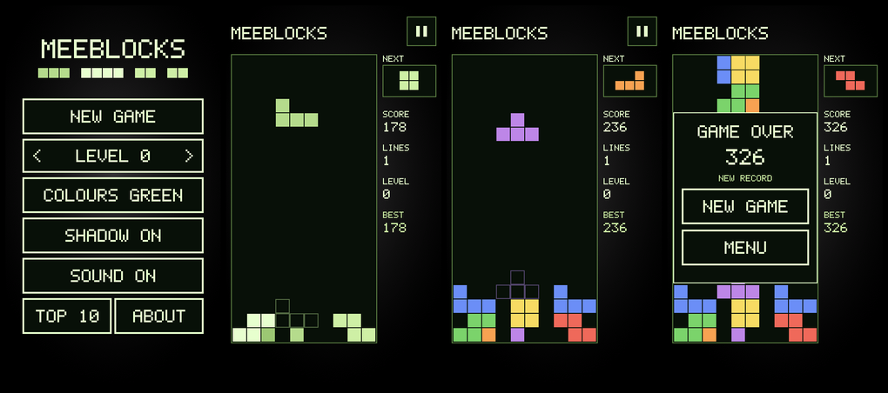

# MeeBlocks for Nokia N9

A falling blocks puzzle for the Nokia N9 (MeeGo Harmattan) in a raw 8-bit / Atari style: flat square blocks, a black well, a chunky pixel font and simple chip sounds.



## Features

- 10 × 20 well, 7 pieces, fair "bag of 7" order, next piece preview
- Touch controls made for the N9 screen:
  - slide left / right: move the piece (it follows your finger)
  - slide up / down: rotate (up = clockwise, down = counter-clockwise)
  - double tap: the piece slides down to where its shadow shows and locks
- Smooth piece movement and rotation, shadow piece (can be switched off)
- Start level 0–9, the game speeds up every 10 lines
- Green or rainbow colours
- Simple 8-bit sounds (can be switched off)
- Local TOP 10 (`~/.meeblocks/scores.json`)
- Pauses when you leave the app; the screen stays on while you play
- English and Polish

## Install

Download `dist/meeblocks-n9_0.2.1_armel.deb`, copy it to the phone and install it as root:

```
aegis-dpkg -i meeblocks-n9_0.2.1_armel.deb
```

It needs only system packages (Qt 4.7.4, Qt Components, QtMobility system info and multimedia). MeeBlocks is also part of the [MeeRevive](https://github.com/smyhu/meerevive-n9) installer.

## Build

Native Qt/QML launcher cross-built with clang against the N9 libraries (`build.sh`), packaged with `packaging/make-deb.sh`. The pixel font, buttons and sounds are shared with MeeSnake.

## Credits

Designed and written by Claude (Anthropic) together with [smyhu](https://github.com/smyhu) for the Nokia N9.

MIT License, Copyright (c) 2026 smyhu.
